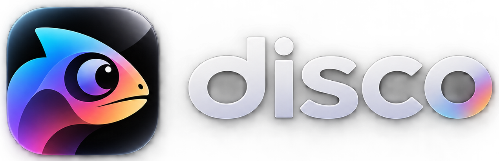

# ColorDisco : Pro Grade Studio (iOS, iPadOS, macOS)

<p align="left">
  
</p>

Studio-grade, 100% offline-first **Dual Video & Photo Native Color Suite** for **iOS (iPhone)**, **iPadOS (iPad)**, and **macOS (Mac)** built with Swift 5.9+/6, SwiftUI, Metal (`MTKView` + custom MSL compute & fragment shaders), Core Image (`CIContext` + `CIRAWFilter`), Accelerate (`vImage`), and AVFoundation (`AVAssetReader` / `AVAssetWriter`).

## Brand Assets & `@samios` Placement

| Asset File | Asset Catalog Name | `@samios` UI/UX Placement |
| :--- | :--- | :--- |
| `disco-icon.png` | `AppIcon` / `DiscoIcon` | **Icon Only**: Native iOS/iPadOS/macOS App Icon (`AppIcon.appiconset`), favicon/apple-touch-icon, macOS window bar badge, and Export Sheet header badge. |
| `logo-text-only.png` | `DiscoLogoText` | **Logo Text Only**: Compact iOS 26 Navigation Bar inline title (`.ios-navbar__inline-title`) on iPhone & iPad to keep the top bar balanced. |
| `icon-logo-text.png` | `DiscoIconLogoText` | **Icon + Logo Lockup**: Primary studio header inside the iPad/Mac Split-View Sidebar, Empty State (`.ios-empty`) hero lockup, and top Studio Harness bar. |

## Full Feature Set

1. **Dual Media Handling (Video & Still Photo)**:
   - **Video Ingestion**: Real-time 60fps decoding via `AVPlayerItemVideoOutput` and frame-accurate offline master export via `AVAssetReader` + `AVAssetWriter` (supports Apple Log, 4K60, HDR10 / Dolby Vision / HLG, and SDR).
   - **Photo Ingestion**: Native decoding of **Apple ProRAW / DNG** (via `CIRAWFilter` with full linear dynamic range), HEIC, PNG, TIFF, and JPEG into full-precision float `CIImage`.
2. **8-Stage Deterministic Color Correction Pipeline**:
   - **Stage 1 (Input Normalization)**: One-click **Apple Log to Rec.709** transform and automatic HDR PQ/HLG to Rec.709 100-nit SDR tonemapping.
   - **Stage 2 (Primary Grading)**: Exposure (EV), Contrast, S-Curve Contrast, Kelvin White Balance & Green/Magenta Tint, Highlights, Shadows, Whites, Blacks, Skin-Safe Vibrance, and Saturation.
   - **Stage 3 (4-Channel Parametric Tone Curves)**: Interactive 5-point Bezier spline curves for **Master (Luma), Red, Green, and Blue** with Matte/Faded Blacks and Film S-Curve presets.
   - **Stage 4 (8-Channel HSL Warper + Skin Tone Protection Lock)**: Targeted Hue Shift, Saturation, and Luminance controls for **Red, Orange, Yellow, Green, Cyan, Blue, Purple, and Magenta** with a dedicated **Skin Tone Protection Lock** that isolates and protects human skin tones.
   - **Stage 5 (3D LUT Ingestion)**: `.cube` text parser ($2^3$ to $65^3$ cubes) and 2D HALD-PNG decoder with dynamic **LUT Opacity/Intensity** ($0.0 - 1.0$) blending.
   - **Stage 6 (3-Way Color Wheels)**: Lift (Shadows), Gamma (Midtones), and Gain (Highlights) chromaticity offset and master luma sliders.
   - **Stage 7 (Film Emulation Engine)**:
     - **Halation**: Warm red/amber scatter around high-contrast edges and specular highlights.
     - **Dynamic Procedural Film Grain**: Per-frame organic simplex/golden-ratio emulsion noise in Metal with adjustable grain size (16mm / 35mm) and roughness.
   - **Stage 8 (Anti-Banding Micro-Dither Guard)**: Zero-mean `0.5 LSB` Triangular PDF dither to prevent 8-bit quantization banding on flat skies and shadows when compressed by Instagram Reels, TikTok, or YouTube Shorts.
3. **Real-Time GPU/Accelerate Colorist Scopes (`ScopesView.swift` & `Shaders.metal`)**:
   - **RGB & Luma Waveform** ($0 - 100$ IRE)
   - **Polar Vectorscope** with dedicated **Skin Tone I-Line**
   - **4-Channel Histogram** (Red, Green, Blue, Luma)
4. **Workflow, Presets & Offline Batch Processing (`BatchExporter.swift`)**:
   - **Interactive A/B Comparison**: Hold-to-preview original media bypass and draggable vertical A/B split-screen wipe.
   - **Grade Management**: JSON-serializable `Codable` recipes, local preset library, and instant **Copy Grade / Paste Grade** across photos and video clips.
   - **Offline Batch Processing**: Background rendering across multiple photos (`JPEG Rec.709/sRGB`, `16-Bit TIFF`, `Lossless PNG`) and videos (`H.264 High Profile L4.2`, explicit `ITU_R_709_2` color tags, CFR `14 Mbps` @ 30fps / `20 Mbps` @ 60fps) with `autoreleasepool` buffer reuse.

## Repository Structure

```text
├── DESIGN.md
├── Package.swift
├── README.md
├── apple_ecosystem_video_color_grading_master_prompt.md
├── tambah-fitur.md
├── prototype/
│   ├── index.html
│   └── sample_kodak_2383.cube
└── Sources/
    └── ColorDisco/
        ├── BatchExporter.swift
        ├── ColorDiscoApp.swift
        ├── ColorGradingEngine.swift
        ├── ColorGradingModels.swift
        ├── ContentView.swift
        ├── LUTParser.swift
        ├── ScopesView.swift
        ├── Shaders.metal
        ├── VideoExporter.swift
        └── VideoPlayerView.swift
```
